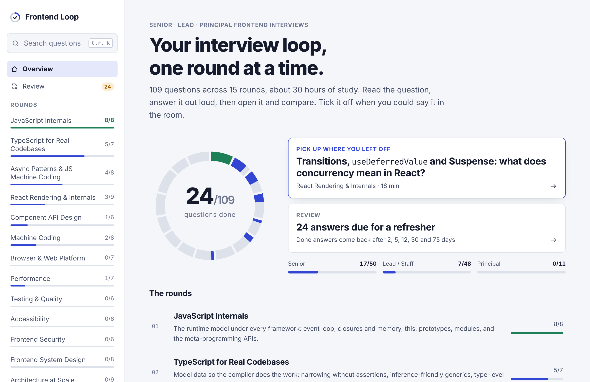
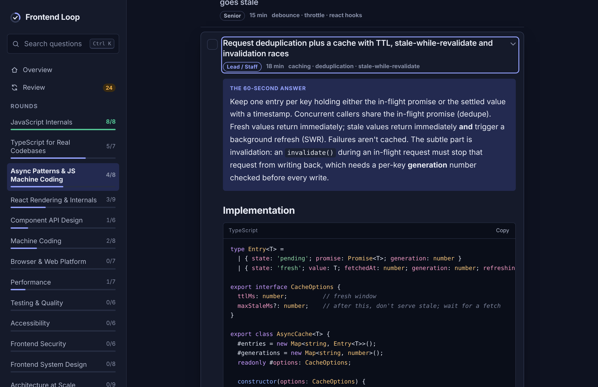
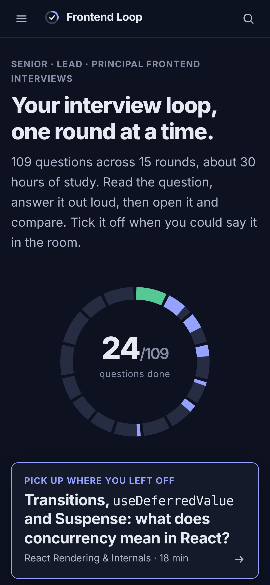

# Frontend Loop

**Interview prep for senior, lead and principal frontend engineers.** 109 deep, interview-grade questions across 15 "rounds" of a real frontend interview loop, with progress tracking, resume-where-you-left-off, spaced review and a practice mode that makes you answer out loud before you read.

**Hosted version:** https://claude.ai/artifact/WXur8AanHGrgRZpkh4Jg9i (a claude.ai Artifact: private to its owner until shared; progress there syncs across devices). The owner is the app's **super admin**, with a live learner dashboard and announcements; invite people through the page's Share menu. See [docs/ADMIN.md](docs/ADMIN.md).



| Question view (dark) | Mobile |
| --- | --- |
|  |  |

---

## Contents

- [What it does](#what-it-does)
- [The question bank](#the-question-bank)
- [Quick start](#quick-start)
- [Scripts](#scripts)
- [Tech stack and why](#tech-stack-and-why)
- [Architecture at a glance](#architecture-at-a-glance)
- [How your progress is saved](#how-your-progress-is-saved)
- [Admin and inviting people](#admin-and-inviting-people)
- [Project structure](#project-structure)
- [Testing and quality](#testing-and-quality)
- [Deployment](#deployment)
- [This repo as a learning project](#this-repo-as-a-learning-project)
- [Roadmap](#roadmap)
- [Docs index](#docs-index)

## What it does

- **Rounds and accordions.** Each topic is a round; each question is an accordion row showing only the question, its level (Senior, Lead/Staff, Principal), study time and tags. Expand it for the full answer.
- **Answers built for the room.** Every answer opens with *the 60-second answer*, then the mental model, correct TypeScript/React code with a copy button, trade-offs, edge cases, production vs interview differences, likely follow-ups, common mistakes and primary references.
- **Tick it off.** A checkbox on every row (and "Mark done & next" inside the answer). Progress is saved automatically.
- **Pick up where you left off.** The overview's main action reopens the question you were on, or the next one you haven't done.
- **The loop ring.** One ring, one arc per round, filled as you go. Per-level progress below it.
- **Spaced review.** Done answers come back after 2, 5, 12, 30 and 75 days. "Still solid" pushes them out; "Needs another pass" puts them back on your list.
- **Practice mode.** Hides each answer behind "Answer it out loud first" with a stopwatch. Active recall beats re-reading.
- **Your own notes** per question, saved as you type. Ideal for behavioral stories in your own words.
- **Search everything** with `/` or `Ctrl/⌘ K`; filters by status and level; deep links to every question (`#oauth-pkce-flow`).
- **Super admin (owner only):** an Admin page with a live dashboard of every learner's progress, an announcement banner you control, and invite instructions with a copy-link button. Enforced by database access rules, not just hidden UI.
- **Export/import** progress as JSON, reset with confirmation, light/dark/system theme, responsive down to small phones, keyboard and screen-reader friendly.

## The question bank

| # | Round | Questions | Highlights |
| --- | --- | --- | --- |
| 01 | JavaScript Internals | 8 | Event loop and rendering, memory leaks, ESM vs CJS, Proxy reactivity, WeakRef |
| 02 | TypeScript for Real Codebases | 7 | Narrowing without `as`, generics inference, conditional/mapped types, unsoundness |
| 03 | Async Patterns & JS Machine Coding | 8 | Promise combinators, pool with cancellation, retry + jitter, debounce, SWR cache |
| 04 | React Rendering & Internals | 9 | Render/commit, re-renders, effects, concurrency, React 19, RSC, compiler |
| 05 | Component API Design | 6 | Compound components, headless hooks, controllable state, RHF + zod |
| 06 | Machine Coding | 8 | Typeahead, virtual list, modal, OTP, undo/redo, infinite feed, timer, uploader |
| 07 | Browser & Web Platform | 7 | Rendering pipeline, HTTP caching, CORS, resource hints, service workers, workers |
| 08 | Performance | 7 | LCP/INP/CLS diagnosis, INP deep dive, bundles, images/fonts, budgets |
| 09 | Testing & Quality | 6 | Strategy, Testing Library, MSW, flaky E2E and CI speed, async tests |
| 10 | Accessibility | 6 | Rules of ARIA, focus management, keyboard patterns, live regions, a11y at scale |
| 11 | Frontend Security | 6 | XSS in React, CSP + Trusted Types, token storage/BFF, CSRF, PKCE, supply chain |
| 12 | Frontend System Design | 8 | Framework, news feed, PDP, real-time dashboard, spreadsheet, collab editor, offline |
| 13 | Architecture at Scale | 9 | Micro-frontends, monorepos, migrations, rendering choices, state ownership, observability |
| 14 | AI-Powered Frontends | 6 | Streaming LLM UI, streaming Markdown, generative UI, RAG UX, cost, evals |
| 15 | Leadership & Behavioral | 8 | Story bank, migration story, disagreement, mentoring, tech debt, RFCs, influence |

About 30 hours of study in total. 50 questions are tagged Senior, 48 Lead/Staff, 11 Principal.

The core utilities in rounds 03, 06 and 14 (combinators, pool, retry, debounce/throttle, SWR cache, emitter, deep clone, latest-wins, virtual list index, undo history, upload queue, SSE parser, Markdown block splitter) were extracted, type-checked under strict TypeScript and run against test cases during development.

## Quick start

Requirements: **Node 22.18+** (the scripts and unit tests run TypeScript directly via Node's type stripping).

```bash
npm install
npm run dev            # http://localhost:5173
```

Then open a round, expand a question, and tick it off.

## Scripts

| Script | What it does |
| --- | --- |
| `npm run dev` | Vite dev server; editing `content/*.md` reloads the page |
| `npm run build` | Validate content → type-check → Vite production build into `dist/` (code-split per round) |
| `npm run build:single` | One self-contained HTML file in `dist-single/` (esbuild) |
| `npm run preview` | Serve `dist/` locally |
| `npm run content:check` | Validate every question and print a per-round summary |
| `npm run typecheck` | `tsc --noEmit` (strict) |
| `npm test` | Unit tests with `node --test` (no extra dependencies) |
| `npm run test:e2e` | Playwright tests against the production build (desktop + mobile) |
| `npm run check` | content check + typecheck + unit tests |

## Tech stack and why

| Choice | Why |
| --- | --- |
| **React 19 + TypeScript (strict)** | Familiar, modern (`use`, Suspense, transitions), strict typing with `noUncheckedIndexedAccess` and `erasableSyntaxOnly` |
| **Vite** | Fast dev server, simple plugin API for the content pipeline, static output |
| **Markdown content compiled at build time** (marked + highlight.js) | No parser or highlighter shipped to users; content errors fail CI; safe HTML by construction |
| **Tiny external store + `useSyncExternalStore`** | The state is small; 30 lines beat a library and show the mechanism |
| **Plain CSS with design tokens** | Exact light/dark theming, zero runtime |
| **`node --test`** for logic, **Playwright** for E2E | Fast, dependency-light unit tests; real-browser confidence |
| **esbuild single-file build** | Host anywhere, open from disk, embed in platforms that want one file |

Each choice is recorded with context and consequences in [docs/DECISIONS.md](docs/DECISIONS.md).

## Architecture at a glance

```text
content/*.md ──▶ build/content (parse · validate · highlight · escape) ──▶ virtual modules
                                                                            ├─ virtual:content (metadata + search text, eager)
                                                                            └─ virtual:content/section/<id> (answer HTML, lazy per round)
Browser
  App shell (sidebar · drawer · search dialog · settings)
  ├─ Overview (loop ring, resume, review, rounds)
  ├─ Round page (filters · accordion items · Answer via use()+Suspense · notes · practice gate)
  └─ Review (due list · upcoming)
  Stores: progress · prefs · route  ──▶ localStorage · other tabs · optional cloud doc
```

Details, module boundaries, data model and sync protocol: [docs/ARCHITECTURE.md](docs/ARCHITECTURE.md).

## How your progress is saved

- **In your browser**, instantly, under `frontend-loop:progress:v1` in localStorage. It's validated on every read, so old or corrupted data never breaks the app.
- **Across tabs**: open tabs merge each other's changes.
- **Across devices** when hosted as a claude.ai Artifact: progress syncs to a private per-user document (`data/users/<your id>/progress`) that only you can read. Merge is last-writer-wins per question, so ticking on your phone and your laptop both count.
- **Anywhere else**: Settings → *Copy progress as JSON* / *Import…* moves progress between browsers.

Nothing is sent to any analytics service.

## Admin and inviting people

- **You are the super admin** because you own the hosted artifact. The sidebar shows **Admin** (with a *Super admin* chip) only to you.
- **Invite**: open the hosted page in claude.ai → **Share** → add people or your organization → give learners **Contributor** access → send the link (Admin has a copy button).
- **Dashboard**: every Contributor who opens the app appears with progress, rounds finished, last activity and current round, live.
- **Announcements**: post a banner everyone sees until they dismiss it.
- **Privacy**: learners share only a summary; notes and review schedules stay private, and Settings tells them so.
- Viewers can study but their progress stays in their browser; Editors can republish the page but can't see the dashboard.

Full details, access rules and verification: [docs/ADMIN.md](docs/ADMIN.md).

## Project structure

```text
frontend-loop/
├─ content/                 15 rounds of questions (Markdown, one file per round)
├─ build/
│  ├─ content/              pure compiler: frontmatter, markdown renderer, compile, codegen
│  └─ vite-plugin-content.ts
├─ scripts/                 build-single-file.ts (esbuild), check-content.ts
├─ src/
│  ├─ app/                  App shell, Sidebar
│  ├─ features/             overview · section · review · search · settings
│  ├─ components/           Icon, LoopRing, primitives (Dialog, ErrorBoundary, …)
│  ├─ content/              types (shared with the compiler), content API + answer loader
│  ├─ state/                stores, pure progress model, selectors, router, persistence
│  ├─ lib/                  search, spaced-review ladder, formatting
│  ├─ styles/               tokens, base, layout, components, prose + syntax colors
│  └─ types/                window.claude runtime types, asset modules
├─ tests/                   unit tests (node:test)
├─ e2e/                     Playwright specs
├─ docs/                    PRD, architecture, ADRs, content guide, learning guide, screenshots
└─ .github/workflows/       CI and optional GitHub Pages deploy
```

## Testing and quality

- **Content validation**: every question needs an id, level, tags, minutes and a TL;DR; ids are unique; only known code languages and callouts are allowed. Errors print `file:line "Question"`.
- **Unit tests** (35): compiler (including XSS escaping and unsafe links), progress model, merge properties, parsing untrusted data, search ranking, resume logic, review queue, and the cloud sync protocol against a fake remote document, learner summaries (no notes leak), summary write coalescing, read-only access and announcements.
- **E2E** (11, Playwright): the exact hosted build rendered inside a sandboxed iframe with a strict Content-Security-Policy (with and without storage access); tick → reload → resume with notes; keyboard search and deep links; practice mode; import → review → reset; filters, theme and skip link; mobile drawer with no horizontal overflow; owner dashboard + announcement, learner restrictions and privacy notice, view-only fallback (against an in-memory runtime enforcing the published access rules).
- **CI** runs content check, type check, unit tests, both builds and E2E on every PR.

## Deployment

The output is static; pick any host.

**Vercel** (zero config): import the repo, framework preset *Vite*, build `npm run build`, output `dist`.

**Netlify**: build `npm run build`, publish `dist`.

**GitHub Pages**: enable *Settings → Pages → Source: GitHub Actions*; `.github/workflows/deploy-pages.yml` builds and deploys on push to `main`. The relative `base: './'` in `vite.config.ts` makes sub-path hosting work.

**Single file**: `npm run build:single` and host or share `dist-single/frontend-loop.html` (works from disk). `dist-single/artifact.html` is the same app without the `<html>/<head>` wrapper, for hosts that provide their own document shell, such as claude.ai Artifacts.

Hash routing means no server rewrite rules are needed anywhere.

## This repo as a learning project

The app uses the techniques its answers teach: `useSyncExternalStore` stores, React 19 `use()` with Suspense and error-boundary retry, adjusting state during render instead of effects, an ARIA combobox with `aria-activedescendant`, native `<dialog>`, local-first sync with a last-writer-wins merge, build-time XSS-safe rendering, a Vite plugin with virtual modules, and dependency-free tests.

[docs/LEARNING_GUIDE.md](docs/LEARNING_GUIDE.md) maps each file to the question it illustrates and lists 14 graded exercises (keyboard shortcuts, component tests, confidence ratings with a data migration, mock-interview mode, virtualization, offline PWA, worker search, a real backend sync adapter, observability, AI follow-up questions, and two principal-level writing exercises).

## Roadmap

- Component tests with Testing Library + Vitest.
- Offline PWA with an update prompt.
- Mock-interview mode (timed random sets) and per-question confidence ratings feeding the review schedule.
- Optional AI-generated follow-up questions, streamed from a small backend.
- More rounds: CSS architecture and layout, internationalization, mobile web and PWAs, data visualization.

## Docs index

| Doc | Purpose |
| --- | --- |
| [docs/PRD.md](docs/PRD.md) | Problem, personas, goals and non-goals, user stories, requirements, metrics, release plan |
| [docs/ARCHITECTURE.md](docs/ARCHITECTURE.md) | Build pipeline, runtime modules, state model, sync protocol, routing, performance, a11y, security, testing |
| [docs/DECISIONS.md](docs/DECISIONS.md) | Eleven architecture decision records |
| [docs/CONTENT_GUIDE.md](docs/CONTENT_GUIDE.md) | How to write and add questions |
| [docs/LEARNING_GUIDE.md](docs/LEARNING_GUIDE.md) | Code tour and exercises |
| [docs/ADMIN.md](docs/ADMIN.md) | Roles, inviting people, dashboard data, access rules |

## Development notes

This version was built in a sandbox without npm registry access. Everything except the Vite toolchain was exercised there: content compilation and validation, strict type-checking of all non-React modules, the 35 unit tests, the esbuild single-file build, and the 11 Playwright E2E tests in Chromium against that build. The Vite dev server/build path (`vite.config.ts`, `build/vite-plugin-content.ts`) and type-checking of the React components against `@types/react` should be confirmed on first local run with `npm install && npm run build && npm run test:e2e`.
